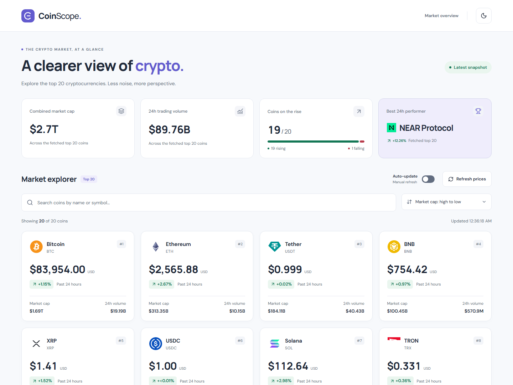

# CoinScope

**A clearer view of crypto.** A responsive cryptocurrency market dashboard built for the Yaama Tech Senior Frontend Developer assessment.



Screenshots show a live API snapshot captured during development; prices and rankings change over time. [Dark theme](docs/screenshots/desktop-dark.png) · [Mobile view](docs/screenshots/mobile-light.png)

## Run locally

Use **Node.js 24.15+ in the 24.x line, or Node.js 26+**, and npm. `.nvmrc` pins a compatible Node 24 version. No environment variables or API keys are required for the public endpoint in this assessment.

```sh
npm ci
npm run dev
```

Open the local address printed by Vite, normally `http://127.0.0.1:5173`.

```sh
npm run build
npm run preview
```

The production build is written to `dist/` and can be served by a static host.

## Features

- Top 20 cryptocurrencies by market capitalization, fetched directly from CoinGecko in USD.
- Icon fallback, full accessible coin name, symbol, formatted price, signed 24-hour change, market cap, and volume.
- One-column mobile, two-column tablet, three-column small desktop, and four-column large desktop card layouts.
- Case-insensitive name/symbol search, clear search, result count, and five sort options including the default market-cap order.
- Dataset overview with accurately scoped totals, rising coins, and best 24-hour performer.
- A compact market-breadth indicator separates rising, falling, unchanged, and unavailable values using the actual fetched data.
- Manual refresh, last successful download time, and an opt-in auto-update toggle with 1-, 2-, and 5-minute intervals.
- Initial skeletons, retryable errors, rate-limit cooldown, empty search, empty API response, offline notice, and reconnect recovery.
- Background refresh preserves existing cards; failure warns that displayed prices may be outdated.
- Persistent light/dark themes, system preference support, reduced motion, keyboard focus, and semantic status announcements.
- Locally served fonts; no third-party font requests at runtime.
- Unit, component, and production browser tests; a GitHub Actions verification workflow.

## Technology and structure

React + strict TypeScript + Vite keep the application small and easy to run. TanStack Query handles server state, caching, cancellation, and reconnection. Search and sorting use local state and pure utilities; no separate global store is needed. CSS variables provide both themes. A shared Radix-based dropdown styles the sorting and interval menus consistently and provides keyboard navigation, typeahead, focus management, and collision-aware positioning. Lucide supplies icons, and Fontsource packages supply DM Sans and Manrope.

```text
src/
  features/
    market/
      api/          # Fetch, error mapping, runtime validation
      components/   # Dashboard, overview, toolbar, cards, states
      hooks/        # Query and cache policy
      styles/       # Market-specific presentation and breakpoints
      types/        # Coin response and UI contracts
      utils/        # Pure filtering, sorting, aggregation
    theme/          # Theme types, preference hook, toggle
  shared/
    components/     # Brand, header, footer
    hooks/          # Connectivity and clock
    utils/          # Currency, change, and timestamp formatting
  styles/           # Design tokens, shared controls, page layout
  test/             # Test setup and synthetic fixtures
e2e/                # Production browser verification
docs/               # Decision notes and live screenshots
```

Tests live next to the behavior they cover. Shared types have their own files. Test fixtures are never imported by the running application.

## API and caching

```text
GET https://api.coingecko.com/api/v3/coins/markets?vs_currency=usd&order=market_cap_desc&per_page=20&page=1&sparkline=false
```

| Behavior | Policy |
| --- | --- |
| Freshness | Two minutes after a successful download |
| Inactive cache retention | 15 minutes in memory |
| Automatic polling | Off by default; toggle on and select 1, 2, or 5 minutes; only while the tab is visible and online |
| Window-focus refetch | Disabled |
| Reconnect | Refetch stale data or resume paused requests |
| Manual refresh | One active request; shared 60s cooldown across refresh/retry buttons; preserve existing prices |
| Request timeout | 15 seconds |
| Transient errors | Up to two retries with 1s / 2s backoff |
| 429 rate limit | At least 60s cooldown, respecting longer `Retry-After`; enabled auto-update resumes afterward |
| Other client errors / invalid data | No automatic retry; explain and offer manual retry |

Runtime validation protects the UI from unexpected responses. Null values remain unavailable and sort last. Incomplete market-cap or volume totals are never silently shown as complete. The overview always describes the fetched top-20 dataset, even when search filters the grid.

The displayed update time is the last successful download time in the viewer's local time. It is not an individual trade timestamp. After two minutes, the snapshot is marked as refreshable. Cache and cooldown do not survive a page reload.

**Auto-update** fetches fresh snapshots at the selected 1-, 2-, or 5-minute interval (default: 1 minute); it is polling rather than a streaming feed. The toggle is off on page load and stays usable during pauses. When enabled, an interval selector replaces the manual refresh button. Changing the interval restarts the schedule without an immediate request; the selection is retained when toggling off/on until the page reloads. Polling pauses while offline or hidden, waits out rate-limit cooldowns, and stops on other errors until a successful manual retry or reconnection. Turning it off stops future scheduled refreshes; a request already in progress can finish. Search and sort are preserved during updates.

CoinGecko's public API may rate-limit, change access policies, or be unreachable from a particular network. The app explains these failures and does not use fabricated prices. React Strict Mode can cancel and restart an initial fetch in development; browser tests run against the production build.

After a manual refresh or retry, the buttons show a countdown for one minute to prevent bursts. Longer server rate-limit deadlines take precedence. When a browser cannot read the server response (for example, a cross-origin error response), the app describes possible service, rate-limit, or connection problems rather than incorrectly blaming the user's internet connection.

See [CoinGecko's market endpoint documentation](https://docs.coingecko.com/reference/coins-markets) and [TanStack Query's cache defaults](https://tanstack.com/query/latest/docs/framework/react/guides/important-defaults).

## Verification

```sh
npm run check          # TypeScript, ESLint, unit/component tests, production build
npx playwright install chromium
npm run test:e2e       # Builds the app and launches a temporary preview server
```

For Linux environments that need browser dependencies, use `npx playwright install --with-deps chromium`.

The browser suite uses port 5173; stop another server on that port before running it. All automated API responses are mocked, including network failures, so tests are independent of live prices and rate limits. Test screenshots and failure traces are written to ignored `test-results/`.

Unit tests cover formatting, filtering, all sort orders, immutable input data, validation, null-aware aggregation, and retry policy. Component tests cover loading, errors, recovery, empty search, and failed background refresh. Browser tests verify responsive column counts, overflow, both themes, persistence, keyboard access, local filtering, offline recovery, rate limiting, and request failure recovery.

Axe scans both themes for WCAG A/AA violations; these automated checks supplement manual inspection and do not replace a full accessibility audit.

GitHub Actions runs these checks on pushes and pull requests. A manual live smoke check also confirmed 20 cards render using the actual endpoint; automated checks deliberately do not rely on that service.

## Accessibility and design

The app provides labeled search and accessible custom dropdown controls, a skip link, semantic landmarks and card headings, focus outlines, live status/error messages, and touch-friendly buttons. Change direction is communicated with text signs and arrows as well as color. Themes use contrasting text and surfaces, and animations respect reduced motion.

Grid breakpoints are 640px, 1024px, and 1200px. Small screens stack the controls while keeping the compact overview in two columns. Tabular numbers, consistent formatting, and a restrained purple accent help readers scan prices and changes.

## Tradeoffs and next steps

This is a focused top-20 dashboard. Pagination and historical charts are omitted; the bonuses implemented are themes and tests. The cache is in memory, and a reload needs a connection. Browser coverage currently targets Chromium; a full production review would add Firefox, Safari, and screen-reader checks. Public API reliability remains external to the application.

With more time: a real-history detail route, URL-persisted filters, currency/locale preferences, and a shared server cache when traffic warrants it.

Read [technical decisions and interview discussion points](docs/technical-decisions.md) for the reasoning behind the implementation.

See the [assessment requirements review](docs/assessment-review.md) for the requirement mapping, verification results, and remaining submission steps.

## Submission

The project is ready to push to a public GitHub repository. Include this README and the lockfile. Keep `node_modules`, build output, test output, and local environment files untracked. After publishing, share the repository link with the recruiter. No repository has been published automatically.
